# EML 4804 Introduction to Mechatronics 
The following page highlights projects from Introduction to Mechatronics done in Spring 2026. 

---

## Project 1: Basic Circuit (01/18/2026)

### Introduction
The purpose of Project #1 is to gain familiarity with the Raspberry PICO board, simple electronic components, and power supplies; to learn how to incorporate them into simple breadboard-based circuits; and to observe how the number of capacitors and the value of resistance affect an LED’s intensity and decay time. 

### Materials and Components
- Breadboard
- Raspberry PICO board
- Power module and LiPo battery in the holder or USB cable
- Red LED
- Resistor 220 Ohm
- Resistor 10 kOhm
- Resistor 100 kOhm
- Tactile switch
- 4 x 10 mF electrolytic capacitors
- Wires
- Switch
- Tactile switch

### Picture 
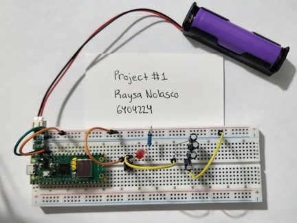

### Video Link
[Project 1 Video](https://youtu.be/WMLkQLneUW4)

### Final Circuit Diagram
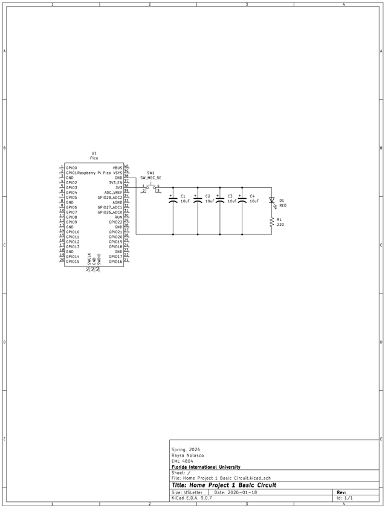

### Data and Discussion
Table 1: 220 Ohm Resistor 
Number of Capacitors	| Decay Time (s)	| LED Emission Intensity
--- | --- | ---
4	| 0.27	| Max Intensity/Bright
3	| 0.26	| Max Intensity/Bright
2	| 0.22	| Max Intensity/Bright
1	| 0.13	| Max Intensity/Bright
0	| 0.11	| Max Intensity/Bright

Table 1: 10 kOhm Resistor 
Number of Capacitors |	Decay Time (s)	| LED Emission Intensity
--- | ---| ---
4	| 1.60 | Medium Intensity 
3	| 1.45 | Medium Intensity 
2	| 1.09 | Medium Intensity 
1	| 0.56 | Medium Intensity 
0	| 0.14 | Medium Intensity 

Table 1: 100 kOhm Resistor 
Number of Capacitors |	Decay Time (s)	| LED Emission Intensity
--- | --- | ---
4	| 11.03	| Low Intensity/Barely Noticeable
3	| 5.89	| Low Intensity/Barely Noticeable
2	| 3.54	| Low Intensity/Barely Noticeable
1	| 2.45	| Low Intensity/Barely Noticeable
0	| 0.13	| Low Intensity/Barely Noticeable

The results demonstrate how the higher the resistance is, the lower the intensity of the LED. The 220 Ohm resistor resulted in the brightest LED, then followed the 10 kOhm resistor, and lastly, the 100 kOhm resistor. Moreover, after reviewing the decay time, one can conclude that more capacitors allow for the light to stay on for longer. 

### Conclusions
**What have you learned?**
My most valuable takeaway from this project was learning how electrical components are connected in series and parallel on a breadboard, a concept I had always been curious about. I also learned how to create a schematic in KiCad and accurately follow it to build a physical circuit on a breadboard. This helped me connect the electrical symbols I am familiar with to their corresponding physical component. Lastly, I learned how an LED’s intensity and decay time are influenced by the number of capacitors and the value of resistance in a circuit. 

**How difficult was this assignment?**
The assignment did not seem overly difficult, largely because was engaging and easy to follow with the assistance of the “Mechatronics with PICO | KiCad basics” video. The main difficulty I encountered was understanding how the components were connected on the breadboard and how I could properly place them in series or parallel. However, following along with the video guide and practicing several times made this concept much easier to understand. 

**How did you overcome challenges?**
The main challenge I encountered during this project was ensuring that my Raspberry PICO board was properly inserted into the breadboard, which was slightly bent. To overcome this issue, I held the breadboard firmly flat while inserting the PICO board and tested the circuit until it functioned correctly. Additionally, I initially struggled to understand how to properly connect components on the breadboard, but following along with the “Mechatronics with PICO | KiCad basics” video and practicing multiple times helped me gain confidence and understanding. 


### References
[1] Durygin, Andriy. “Mechatronics with PICO | KiCad basics”. _YouTube_, uploaded by Mechatronics Fun, 6 September 2024, https://youtu.be/gl4FkAs9G-A?si=MX0BVFvXTePfWLe8. 

---

## Project 2: Introduction to Raspberry Pi Pico W (01/31/2026)

### Introduction
The purpose of this home project is to get familiar with Python coding the RB Pico board using the pin and the time package on the Thonny application to make an LED light up in morse code. 

### Materials and Components
- PICO board
- Breadboard
- LED
- 220-ohm resistor
- Wires

### Picture 
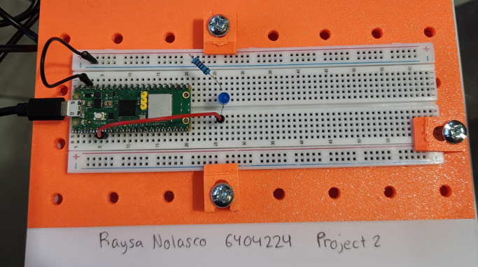

### Video Link
[Project 2 Video](https://youtu.be/aAF2papouOw)

### Final Circuit Diagram
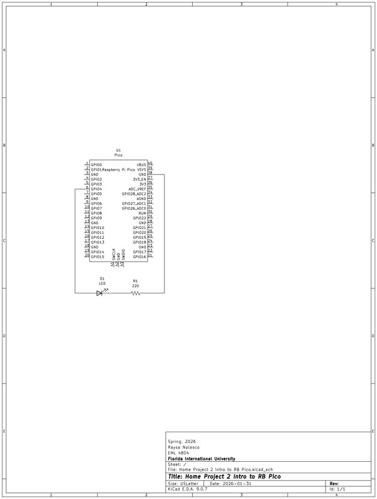

### Code
```python
import time
from machine import Pin

# Output pin for LED on Pin 4
led_onboard = Pin(4, Pin.OUT)

# Morse code for number 2
Num = [".", ".", "-", "-", "-"]

time.sleep(2)

for i in Num:
    if i == ".":
        led_onboard.on()
        time.sleep(1)
        led_onboard.off()
        time.sleep(1)
    else:
        led_onboard.on()
        time.sleep(3)
        led_onboard.off()
        time.sleep(1)
```

### Conclusions
**What have you learned?**
From this home project, I learned about the time package and how time.sleep(#) in code means that the device is being told to wait for # seconds before performing the next line of code. I have used Python before but never related the coding to an RB Pico board with the pin or time packages until now. 

**How difficult was this assignment?**
The assignment was fairly simple. I had quite some fun implementing my previous Python knowledge when writing the code by incorporating a for loop with if else statements. 

**How did you overcome challenges?**
The obstacle I encountered was understanding which pin number to use as my output in the code. Looking at the Pico Pinout diagram, I knew I had to place my wire in the physical pin 6 that corresponds with GP4 based on my PID. However, I originally used the number 6 in my code. When I noticed that the LED did not turn on, I decided to try the number 4. I quickly realized after it worked that for Thonny I must input the GPIO number and not the physical pin number. 

### References
[1] Wikipedia. Morse code [Internet]. Wikipedia; 2026 Jan 30 [cited 2026 Jan 31]. Available from: https://en.wikipedia.org/wiki/Morse_code 

---

## Project 3: Functions and Loops (02/08/2026)

### Introduction
The purpose of this project is to learn how to incorporate functions and loops to perform mathematical calculations and display them on an LCD screen. 

### Materials and Components
- PICO board
- LCD Screen
- Hook-up wires
- Breadboard
- Mechanical breadboard
- LCD stand (3d printed)

### Picture 
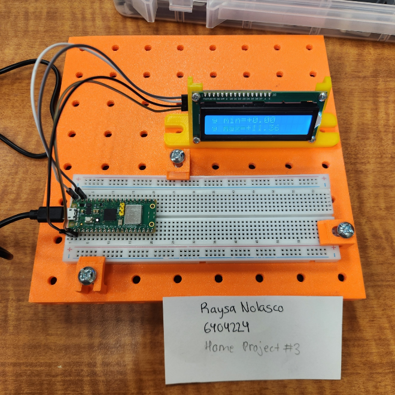

### Video Link
[Project 3 Video](https://youtu.be/ZXQEkVsZucQ)

### Final Circuit Diagram
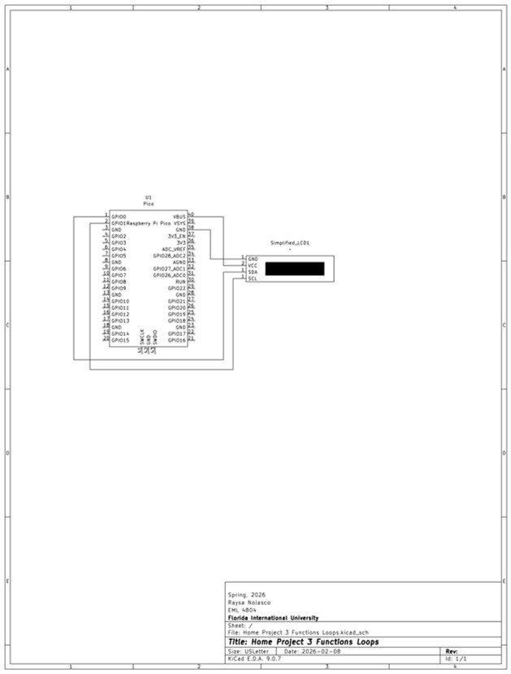

### Code
```python
from lcd1602 import LCD
import utime
import math

lcd = LCD()

# mathematical expression 4 (based off PID)
def expression(x):
    return (x**3)*(math.sin(x/3)/8)

# range for x and step 4 (based off PID)
x_start = -4.5
x_end = 0.5
step = 0.1

# two separate lists
parameters = []
calc_results = []

# show formula and range
lcd.clear()
lcd.write(0, 0, "y=x^3*sin(x/3)/8")
lcd.write(0, 1, "x:-4.5..0.5, 0.1")
utime.sleep(3)

# timing x_start
t0 = utime.ticks_ms()

# number of points
n = int(round((x_end - x_start) / step))

# calculations and list updates
for i in range(n + 1):
    x = round(x_start + i * step, 1)
    y = expression(x)

    parameters.append(x)
    calc_results.append(y)

# displays each x and y
for i in range(len(parameters)):
    lcd.clear()
    lcd.write(0, 0, "x={:+.1f}".format(parameters[i]))
    lcd.write(0, 1, "y={:+.3f}".format(calc_results[i]))
    utime.sleep(1.0)

# min and max
y_min = min(calc_results)
y_max = max(calc_results)

# show ymin and ymax
lcd.clear()
lcd.write(0, 0, "y min={:+.2f}".format(y_min))
lcd.write(0, 1, "y max={:+.2f}".format(y_max))

while True:
    utime.sleep(1)
```

### Conclusions
**What have you learned?**
I learned how to program the LCD to display my proper function. I also learned how to create the LCD symbol on KiCad. 

**How difficult was this assignment?**
The Assignment was fairly difficult as I had to figure out how to create the LCD symbol on KiCad. The assignment also tested my knowledge of Python and required me to find my old notes from when I took Intro to Programming. 

**How did you overcome challenges?**
When I could not find the proper LCD symbol on KiCad, I went to YouTube to find a tutorial to help me accomplish the task. Moreover, I had to find my old notes from when I took Intro to Programming to find how to properly perform the mathematical calculations. 

### References
[1] SunFounder. 2.17 Show characters on I2 LCD1602 [Internet]. SunFounder; 2025 [cited 2026 Feb 08]. Available from: https://docs.sunfounder.com/projects/thales-kit/en/latest/micropython/liquid_crystal_display.html 
[2] Pcb Cupid. #13 How to create custom symbols in KiCad 7.0 with KLC | #PCBCupid [Internet]. YouTube; 2023 Apr 5 [cited 2026 Feb 08]. Available from: https://youtu.be/baCGoK8MuH0?si=hxxLmCfRjdxporrm 

---

## Project 4: LCD, Digital and Analog Inputs, Serial Communication (02/14/2026)

### Introduction
The purpose of the project is to learn how to read digital and analog inputs from a circuit with a tactile switch and potentiometer and display them through an LCD screen as well as communicate them through a serial monitor and plotter. 

### Materials and Components
- Pico board
- LCD Screen
- 10k ohm potentiometer
- Tactile switch
- Hook-up wires
- Breadboard
- 3D printed mechanical board
- 3D printed LCD stand

### Picture and Screenshots
Circuit Set Up:

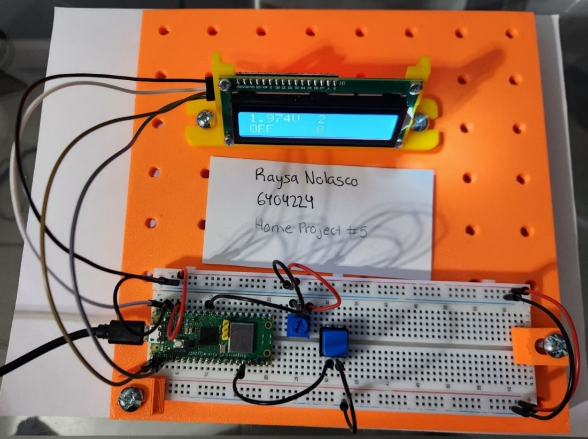

Serial Monitor:

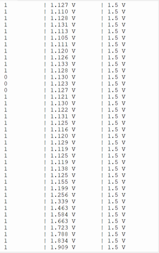

Serial Plotter:

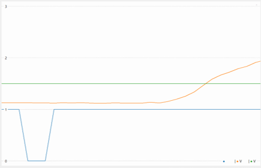

### Video Link
[Project 4 Video](https://youtu.be/oeC5DTwNnEU)

### Final Circuit Diagram
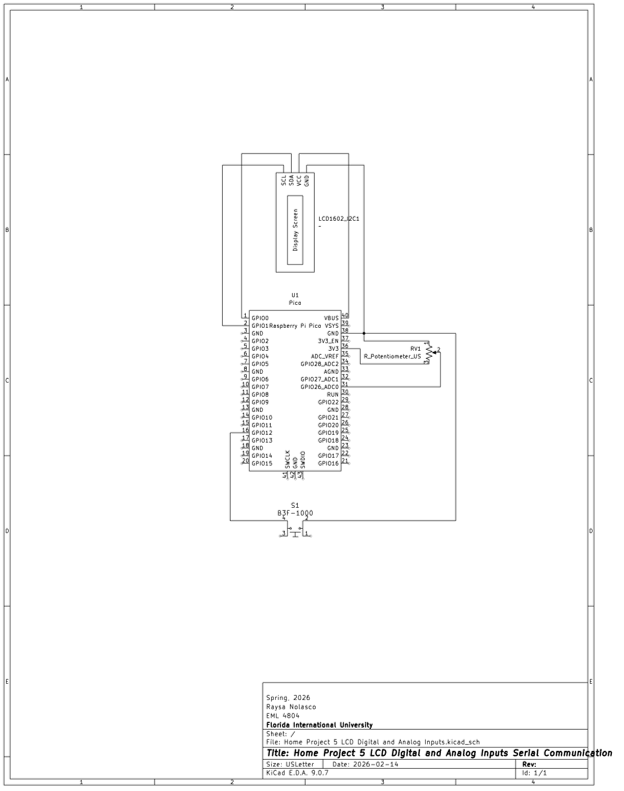

### Code
```python
# Set up
from machine import Pin, ADC
from lcd1602 import LCD
import time

lcd = LCD()

button = Pin(12, Pin.IN, Pin.PULL_UP) # Link the button to pin 12
button_counter = 0 # Will be for # of presses
button_val = button.value() # If button is on or off
if button_val == 0:
    lcd.write(0, 1, "ON      " + str(button_counter))
else:
    lcd.write(0, 1, "OFF     " + str(button_counter))

adc = ADC(Pin(26, Pin.IN)) # Create an ADC object linked to pin 26
pot_val = adc.read_u16() * (3.3 / 65535) # Read ADC and convert to voltage
pot_counter = 0 # Will be for # of times pot_val > 1.5 V when rising
lcd.write(8, 0, str(pot_counter))

print("Button     | Potentiometer | Threshold")
print("on 0/off 1 | Voltage, V    | Voltage")
print("--------------------------------------")

while True:
# Step 3: Digital Input with Switch - Show if button is on or off
# AND Step 5: Counters: Button Press Counter - counts when button is pressed
    new_button_val = button.value()
    if button_val == 1 and new_button_val == 0: # lcd only updates if change
        button_counter += 1
        lcd.write(0, 1, "ON      " + str(button_counter))
    elif button_val == 0 and new_button_val == 1: # lcd only updates if change
        lcd.write(0, 1, "OFF     " + str(button_counter))
    button_val = new_button_val

# Step 4: Analog Input with Potentiometer - Show potentiometer voltage 
    new_pot_val = adc.read_u16() * (3.3 / 65535) # Read ADC and convert to voltage
    if round(pot_val,3) != round(new_pot_val,3):
        lcd.write(0,0,str(round(new_pot_val, 3)) + "V")

# Step 5: Counters: Analog Signal Counter - count when signal increases/rises over 1.5 V
    if pot_val < 1.49 and new_pot_val >= 1.5 and new_pot_val > pot_val:
        pot_counter += 1
        lcd.write(8, 0, str(pot_counter)) # lcd only updates if change
    pot_val = new_pot_val

# Wait a bit before another iteration/loop
    time.sleep_ms(10)
    
# Step 7: Serial Communication
    print("{}          | {:.3f} V       | 1.5 V".format(button_val,pot_val))
```

### Conclusions
**What have you learned?**
A lot of the project involved snip bits of the in-class activities we have done up to this point. Thus, this project helped me practice my skills and learn to merge what I know about digital and analog inputs and about serial communication into one code. Moreover, I learned how to use the Pico’s built in pull-up resistor. I also learned how to make LCD writing more efficient. 

**How difficult was this assignment?**
It was challenging. It required for me to put together a lot of the class practices as well as carefully read through the assignment’s attached sources. 

**How did you overcome challenges?**
The main challenge I had was with properly counting the analog signals that went over 1.5 V. Since the voltage change can be a bit jittery, I had to keep doing a trial and error with the time between my loops. I managed to make the circuit work properly at the speed I was turning my dial. I also had to keep fixing my code to try to make less updates to the lcd screen. The last challenge I faced was that I had to find a library to import for the tactile switch I used since it did not originally appear on my KiCad. 

### References
[1] uPesy. Using I/O with MicroPython on the Pi Pico [Internet]. uPesy; 2023 Jan 23 [cited 2026 Feb 13]. Available from: https://www.upesy.com/blogs/tutorials/micropython-raspberry-pi-pico-gpio-pins-usage 
[2] uPesy. Measure an analog voltage with the Pi Pico ADC in MicroPython [Internet]. uPesy; 2022 Dec 26 [cited 2026 Feb 13]. Available from: https://www.upesy.com/blogs/tutorials/micropython-raspberry-pi-pico-adc-usage-measure-voltage 
[3] Geeks for Geeks. Python – output formatting [Internet]. Geeks for Geeks; 2025 Jul 11 [cited 2026 Feb 13]. Available from: https://www.geeksforgeeks.org/python/python-output-formatting/ 
[4] Digi-Key. Digikey-kicad-library [Internet]. GitHub; 2022 Feb 2 [cited 2026 Feb 13]. Available from:  https://github.com/Digi-Key/digikey-kicad-library 

---

## Project 5: Using of Interrupts, Digital Output, and PWM Output (03/11/2026)

### Introduction
Learn how to incorporate interrupts in a MicroPython code with digital input processing and PWM output using buttons and LEDs with a Raspberry Pi PICO W board and breadboard. 

### Materials and Components
- PICO Board
- Red LED
- Green LED
- White LED
- 3x 220-ohm resistor
- 2x Buttons
- Hook-up wires
- Breadboard

### Picture 
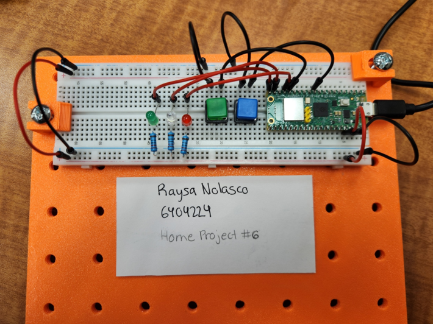

### Video Link
[Project 5 Video](https://youtu.be/_pBchGXA32w)

### Final Circuit Diagram
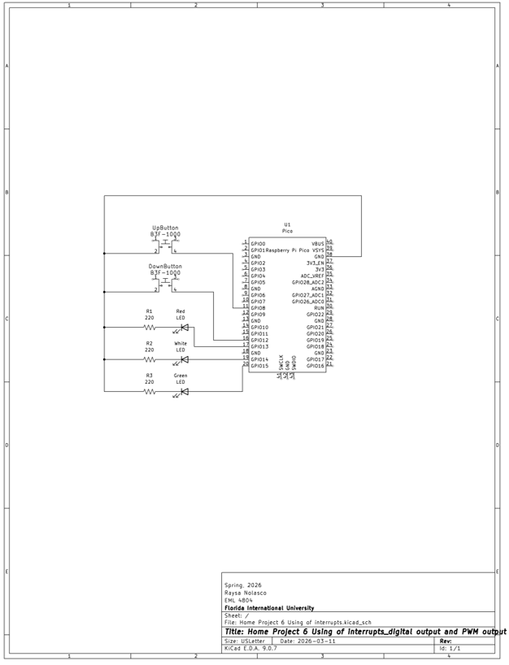

### Code
```python
from machine import Pin, PWM
import time

# Pin Set Up
green_led = Pin(15, Pin.OUT) # green LED for min brightness level
white_led = PWM(Pin(14)) # white LED on GP14
white_led.freq(500)
red_led = Pin(13, Pin.OUT) # red LED for max brightness level
gbutton_down = Pin(12, Pin.IN, Pin.PULL_UP) # green button down in level
bbutton_up = Pin(8, Pin.IN, Pin.PULL_UP) # blue button up in level 

# Blink test at startup 
for i in range(2):
    green_led.on()
    time.sleep(0.2)
    green_led.off()
    time.sleep(0.2)
    
    white_led.duty_u16(65535)
    time.sleep(0.2)
    white_led.duty_u16(0)
    time.sleep(0.2)

    red_led.on()
    time.sleep(0.2)
    red_led.off()
    time.sleep(0.2)

# Brightness levels setup from 0-15 (16 levels)
level = 0
max_level = 15

def update_leds():
    global level

    # Convert 0-15 level to PWM 0-65535
    duty = int((level / max_level) * 65535)
    white_led.duty_u16(duty)

    # Indicator LEDs
    if level == max_level:
        red_led.on()
    else:
        red_led.off()

    if level == 0:
        green_led.on()
    else:
        green_led.off()

# Interrupt functions
def increase_brightness(pin):
    global level
    if level < max_level:
        level += 1
    update_leds()

def decrease_brightness(pin):
    global level
    if level > 0:
        level -= 1
    update_leds()

# Start at minimum brightness
update_leds()

# Interrupts (Buttons use PULL_UP, so press = falling edge)
gbutton_down.irq(trigger=Pin.IRQ_FALLING, handler=decrease_brightness)
bbutton_up.irq(trigger=Pin.IRQ_FALLING, handler=increase_brightness)

# Main loop
while True:
    time.sleep(0.1)
```

### Conclusions
**What have you learned?**
I learned how interrupts work and how to incorporate them in a MicroPython code. I was also able to have more practice using buttons, LEDs, pull up resistors, and PWM.  

**How difficult was this assignment?**
The assignment was not as bad as I thought initially. Reading the first suggested source really helped me understand how to properly implement interrupts and the rest of the physical circuit felt like more practice from concepts we have already seen. 

**How did you overcome challenges?**
When I first ran the full code I created, I realized that the right LED did not seem to be turning on at minimum brightness level. I kept playing with the buttons until I noticed that the green and red LED were flipped. I then corrected my error and was able to get a working circuit/code. 

### References
[1] uPesy. How to use interrupts in MicroPython with a Pico RPi? [Internet]. uPesy: 2023 Feb 2 [cited 2026 Mar 11]. Available from: https://www.upesy.com/blogs/tutorials/hardware-interrupts-rpi-pico-on-micropython 

---

## Project 6: DIY MPU 6050 Inclinometer (03/22/2026)

### Introduction
The purpose of this project is to understand roll and pitch angles, how to derive them from an MPU 6050 inclinometer, and how to filter the values with a low pass filter as well as display the roll angle through an LED bar graph that implements a calibration button. 

### Materials and Components
- LED bar graph
- 10 x 220 ohm Resistors
- MPU 6050 Module
- RP PICO board
- Button
- Breadboard
- Wires
- Capacitor

### Picture 
Plotter Window: 

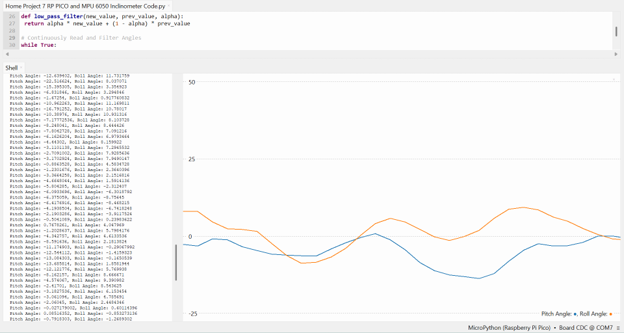

Circuit Set Up: 

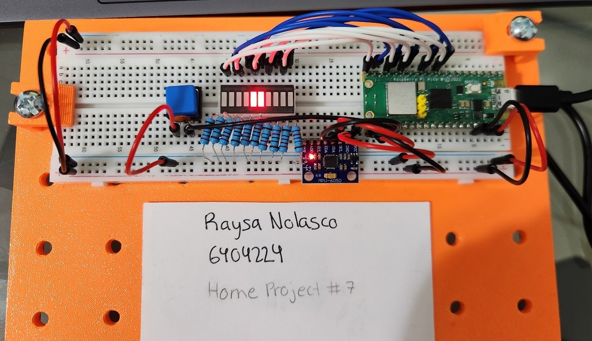

### Video Link
[Project 6 Video](https://youtu.be/VjyFVWdxhJI)

### Final Circuit Diagram
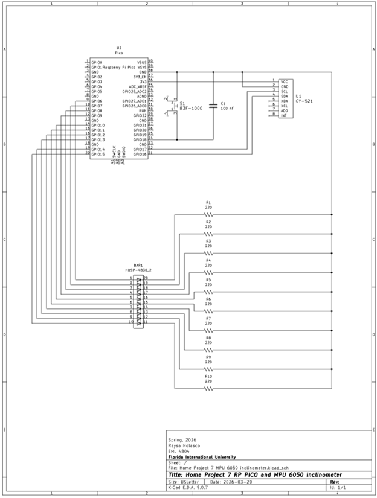

### Code
```python
from imu import MPU6050
from machine import I2C, Pin
import time
import math

## Set Ups
# MPU 6050 Set Up
i2c = I2C(0, sda=Pin(16), scl=Pin(17), freq=400000)
mpu = MPU6050(i2c)

# LED Bar Graph Set Up
pin = [6,7,8,9,10,11,12,13,14,15]
led= []
for i in range(10):
    led.append(Pin(pin[i], Pin.OUT))

# Button Set Up
button = Pin(18, Pin.IN, Pin.PULL_UP)

# Smoothing Factor
alpha = 0.3

# Calibration Values
pitch_offset = 0.0
roll_offset = 0.0

# Interrupt Flag
calibrate_requested = False
##

## Initialize with First Reading
# Read Accelerometer Values (unit: m/s²)
a_x = mpu.accel.x
a_y = mpu.accel.y
a_z = mpu.accel.z

# Convert Acceleration Values from MPU to Roll and Pitch Angles
pitch = 180 * (math.atan2(a_x, math.sqrt(a_y**2 + a_z**2)) / math.pi)
roll = 180 * (math.atan2(a_y, math.sqrt(a_x**2 + a_z**2)) / math.pi)
print("Pitch Angle: %s, Roll Angle: %s"%(pitch, roll))

filtered_pitch = pitch
filtered_roll = roll
##

## Functions
# Low Pass Filter
def low_pass_filter(new_value, prev_value, alpha):
 return alpha * new_value + (1 - alpha) * prev_value

# Clear all LEDs
def clear_bar():
    for i in range(10):
        led[i].value(0)

# Display Roll Angle on LED Bar Graph
def display_roll(roll):
    clear_bar()

    # If Roll Goes Beyond Range
    if roll > 4:
        roll = 4
    elif roll < -4:
        roll = -4

    # Convert Roll Angle to Corresponding Left LED Index [for LED Pair]
    position = 8 - int(roll + 4)
    
    # Turn On Corresponding LED Pair
    led[position].value(1)
    led[position + 1].value(1)

# Save Calibration Values to File and Signal Calibration
def save_calibration(pitch_val, roll_val):
    f = open('calibration.txt', 'w')
    f.write(str(pitch_val) + "\n")
    f.write(str(roll_val) + "\n")
    f.close()
    clear_bar()
    for i in range(10):
        led[i].value(1)
        time.sleep(0.1)
        led[i].value(0)
        time.sleep(0.1)

# Load Calibration Values from File
def load_calibration():
    global pitch_offset, roll_offset
    try:
        f = open('calibration.txt', 'r')
        pitch_offset = float(f.readline())
        roll_offset = float(f.readline())
        f.close()
    except:
        pitch_offset = 0.0
        roll_offset = 0.0

# Interrupt Function
def button_pressed(pin):
    global calibrate_requested
    calibrate_requested = True
##

# Load Saved Calibration
load_calibration()

# Button Interrupt
button.irq(trigger=Pin.IRQ_FALLING, handler=button_pressed)

## Continuously Read, Filter, Calibrate, and Display
while True:
    # Read Accelerometer Values (unit: m/s²)
    a_x = mpu.accel.x
    a_y = mpu.accel.y
    a_z = mpu.accel.z
    
    # Convert Acceleration Values from MPU to Roll and Pitch Angles
    pitch = 180 * (math.atan2(a_x, math.sqrt(a_y**2 + a_z**2)) / math.pi)
    roll = 180 * (math.atan2(a_y, math.sqrt(a_x**2 + a_z**2)) / math.pi)
    
    # Apply Low Pass Filter
    filtered_pitch = low_pass_filter(pitch, filtered_pitch, alpha)
    filtered_roll = low_pass_filter(roll, filtered_roll, alpha)
    
    # Check if Calibration Button was Pressed
    if calibrate_requested:
        calibrate_requested = False
        pitch_offset = filtered_pitch
        roll_offset = filtered_roll
        save_calibration(pitch_offset, roll_offset)
        print("Calibration saved")

    # Apply Calibration Correction
    corrected_pitch = filtered_pitch - pitch_offset
    corrected_roll = filtered_roll - roll_offset
    
    print("Pitch Angle: %s, Roll Angle: %s"%(corrected_pitch, corrected_roll))
    
    # Display Corrected Roll Angle on LED Bar Graph
    display_roll(corrected_roll)
    
    time.sleep(0.1)
##
```

### Conclusions
**What have you learned?**
I learned a lot creating this project. For starters, I learned about MPU 6050’s and how they work. I also learned how the x-, y-, and z-axis are also known as the roll, pitch, and yaw axis. Moreover, I learned how to calculate the roll and pitch angles using the accelerometers in the MPU 6050 and how to make an LED bar graph display the roll angle. Additionally, I learned how to better my code through the use of a low pass filter and debouncing with a capacitor. Finally, I learned how to write and read files on Thonny. 

**How difficult was this assignment?**
The assignment proved to be a bit challenging, but it was definitely rewarding. I definitely appreciate the step by step walk through for the assignment instructions as it helped break down the project into digestible chunks. I also was a bit unsure of how to go about lighting the LEDs proportionally. I decided to code the LED bar graph to display a pair of LEDs based off the roll angle. 

**How did you overcome challenges?**
I struggled to understand how to implement the digital low pass filter to the code to filter the noise around the accelerometers. I also struggled with the calibration button. After rereading through the class PowerPoint lecture and experimenting, I managed to make the code work. Another challenge I encountered was organizing the code. I decided to use double hashtags (##) for headings and single hashtags (#) for subheadings to make my code clearer to me as the code began to grow lengthy. I also removed unused lines of code for the sake of cleanliness. 

### References
[1]	Aircraft principal axes [Internet]. Wikipedia; 2025 Oct 22 [cited 2026 Mar 20]. Available from: https://en.wikipedia.org/wiki/Aircraft_principal_axes
[2]	6.3 6-axis motion tracking [Internet]. SunFounder; 2025 [cited 2026 Mar 20]. Available from: https://docs.sunfounder.com/projects/kepler-kit/en/latest/pyproject/py_mpu6050.html
[3]	Huang, M. Kepler-kit-for-raspberry-pi [Internet]. GitHub: SunFounder; 2025 Aug 21 [cited 2026 Mar 20]. Available from: https://github.com/sunfounder/kepler-kit/tree/main
[4]	Durygin, A. 07-PICO sensors in mechatronics. 
[5]	2.2 display the level [Internet]. SunFounder; 2025 [cited 2026 Mar 21]. Available from: https://docs.sunfounder.com/projects/kepler-kit/en/latest/pyproject/py_led_bar.html
[6]	Durygin, A. RP PICO and MPU 6050 inclinometer [Video]. YouTube: Mechatronics Fun; 2024 Oct 30 [cited 2026 Mar 22]. Available from: https://youtu.be/Pu4mByKgH_Y

---

This concludes the Introduction to Mechatronics Project Highlights. 
