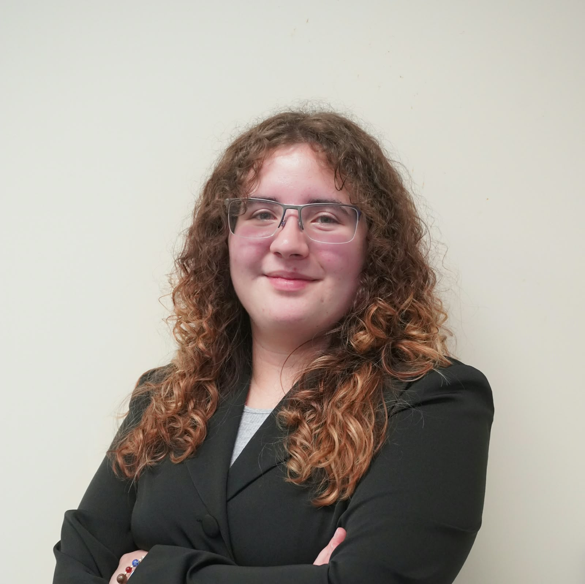

# Meet the Creator

  

Hi! I am Raysa Nolasco, a senior at Florida International University Honors College. These pages explore Mechanical and Mechatronics projects I have worked on through my years of study for my Bachelors of Science in Mechanical Engineering. As you may note through your exploration, I have delved into the wonders of mechatronics this recent year as one Introduction to Mechatronics course opened doors for many more of my future endeavors, driving passion and determination everywhere I may go. As always, I strive to make things more functional and efficient wherever I can. I hope you enjoy your journey as you dive into projects that have made me who I am today. 

Find me on [**Linked In**](www.linkedin.com/in/this-is-raysa-nolasco) and [**Handshake**](https://fiu.joinhandshake.com/profiles/this-is-raysa-nolasco)!

# Introduction to Mechatronics
Check out the [mechatronics projects](https://powerraynger.github.io/Raysa-Nolasco-Portfolio/Intro-to-Mechatronics) carried out by Raysa Nolasco for EML 4804 Introduction to Mechatronics using a Raspberry Pi Pico W microcontroller. 

# Crunch 3D
Check out [Raysa Nolasco and Jorge Marin's 6-week OnShape Course](https://powerraynger.github.io/Raysa-Nolasco-Portfolio/Crunch-3D) for Code Crunch Global!
